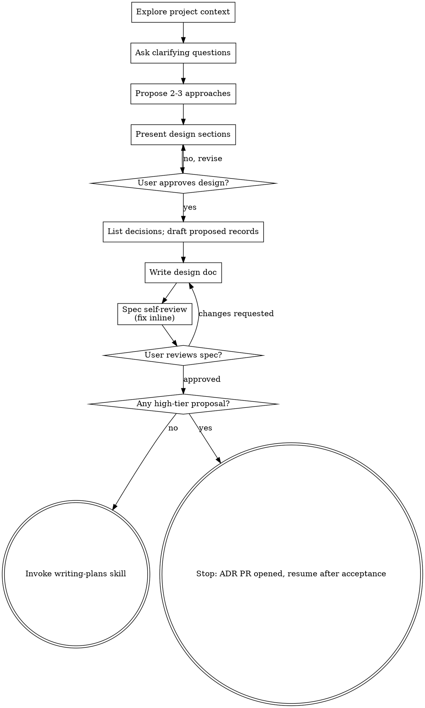

<!-- Adapted from superpowers (MIT license, Copyright Jesse Vincent 2025) -->

# Brainstorming Ideas Into Designs

Help turn ideas into fully formed designs and specs through natural collaborative dialogue.

Start by understanding the current project context, then ask questions one at a time to refine the idea. Once you understand what you're building, present the design and get user approval.

<HARD-GATE>
Do NOT invoke any implementation skill, write any code, scaffold any project, or take any implementation action until you have presented a design and the user has approved it. This applies to EVERY project regardless of perceived simplicity.
</HARD-GATE>

## Anti-Pattern: "This Is Too Simple To Need A Design"

Every project goes through this process. A todo list, a single-function utility, a config change — all of them. "Simple" projects are where unexamined assumptions cause the most wasted work. The design can be short (a few sentences for truly simple projects), but you MUST present it and get approval.

## Checklist

You MUST create a task for each of these items and complete them in order:

1. **Explore project context** — check files, docs, recent commits
   Also dispatch, in parallel (both Task calls in one message), the **knowledge-reader** agent with
   the topic and hint "Prioritise domain context and architecture patterns." and the **architect**
   agent in `bind` mode with the topic. Include both outputs in your project context: the
   architect's binding decisions constrain every approach you propose, and a fired trigger means
   the design must supersede that record (recording-decisions skill) rather than quietly violate it.
2. **Ask clarifying questions** — one at a time, understand purpose/constraints/success criteria
3. **Propose 2-3 approaches** — with trade-offs and your recommendation
   If the chosen approach commits to a hard-to-reverse choice, it will be listed and recorded in
   step 5.
4. **Present design** — in sections scaled to their complexity, get user approval after each section
5. **List the decisions** — before writing the spec, list every decision the design makes, one line
   each, and classify it: *hard to reverse?* (will code depend on it, and does changing it later cost
   more than a day?) For each hard-to-reverse one, invoke **recording-decisions** to **draft and
   show** a `proposed` record — tell it not to apply yet ("draft only; do not apply") — unless a
   binding record from step 1 already covers it. Note each record's tier (high = one-way, shared, or
   any sensitivity). Reversible ones go in the spec as plain design.
6. **Write design doc** — save to `docs/agent/specs/YYYY-MM-DD-<topic>-design.md` with a
   `## Decisions` section: the binding records it follows (by id); for each proposed record, its
   id-to-be/title, a `Tier: high` or `Tier: low` line, and the full drafted record text in a fenced
   ```markdown block, so a later session can apply it without this chat and never has to infer the
   tier; "No new decisions" when there are none; commit
7. **Spec self-review** — quick inline check for placeholders, contradictions, ambiguity, scope (see below)
8. **User reviews written spec** — ask user to review the spec file before proceeding
9. **Transition** — if any proposed record is **high tier**: apply it from the spec's stored draft
   text through recording-decisions (show the record, the user confirms, the knowledge-updater
   applies it as `own-pr`). Then stop with "ADR PR opened: <link>. Resume with writing-plans once
   <id> is accepted." If the user declines, or the session cannot ask (non-interactive), do not
   open anything: stop, name each pending high-tier record by id/title, and say that it must be
   proposed and accepted before planning can resume. **Low-tier** drafts are not applied now.
   writing-plans/implementation applies each stored draft as a ride-along in the implementing PR
   through recording-decisions, listed under *Adds* in the PR's *Decisions* section. With no
   high-tier proposal, invoke writing-plans.

## Process Flow



**The terminal state is invoking writing-plans, or, when the design proposes a high-tier record, stopping until that record is accepted.** Do NOT invoke frontend-design, mcp-builder, or any other implementation skill.

## The Process

**Understanding the idea:**

- Check out the current project state first (files, docs, recent commits)
- Before asking detailed questions, assess scope: if the request describes multiple independent subsystems (e.g., "build a platform with chat, file storage, billing, and analytics"), flag this immediately. Don't spend questions refining details of a project that needs to be decomposed first.
- If the project is too large for a single spec, help the user decompose into sub-projects: what are the independent pieces, how do they relate, what order should they be built? Then brainstorm the first sub-project through the normal design flow. Each sub-project gets its own spec → plan → implementation cycle.
- For appropriately-scoped projects, ask questions one at a time to refine the idea
- Prefer multiple choice questions when possible, but open-ended is fine too
- Only one question per message - if a topic needs more exploration, break it into multiple questions
- Focus on understanding: purpose, constraints, success criteria

**Exploring approaches:**

- Propose 2-3 different approaches with trade-offs
- Present options conversationally with your recommendation and reasoning
- Lead with your recommended option and explain why

**Presenting the design:**

- Once you believe you understand what you're building, present the design
- Scale each section to its complexity: a few sentences if straightforward, up to 200-300 words if nuanced
- Ask after each section whether it looks right so far
- Cover: architecture, components, data flow, error handling, testing
- Be ready to go back and clarify if something doesn't make sense

**Design for isolation and clarity:**

- Break the system into smaller units that each have one clear purpose, communicate through well-defined interfaces, and can be understood and tested independently
- For each unit, you should be able to answer: what does it do, how do you use it, and what does it depend on?
- Can someone understand what a unit does without reading its internals? Can you change the internals without breaking consumers? If not, the boundaries need work.
- Smaller, well-bounded units are also easier for you to work with - you reason better about code you can hold in context at once, and your edits are more reliable when files are focused. When a file grows large, that's often a signal that it's doing too much.

**Working in existing codebases:**

- Explore the current structure before proposing changes. Follow existing patterns.
- Where existing code has problems that affect the work (e.g., a file that's grown too large, unclear boundaries, tangled responsibilities), include targeted improvements as part of the design - the way a good developer improves code they're working in.
- Don't propose unrelated refactoring. Stay focused on what serves the current goal.

## After the Design

**Documentation:**

- Write the validated design (spec) to `docs/agent/specs/YYYY-MM-DD-<topic>-design.md`, including
  the `## Decisions` section (binding records followed; each proposed record's id-to-be/title, a
  `Tier: high` or `Tier: low` line, and full drafted text; or "No new decisions")
  - (User preferences for spec location override this default)
- Use elements-of-style:writing-clearly-and-concisely skill if available
- Commit the design document to git

**Spec Self-Review:**
After writing the spec document, look at it with fresh eyes:

1. **Placeholder scan:** Any "TBD", "TODO", incomplete sections, or vague requirements? Fix them.
2. **Internal consistency:** Do any sections contradict each other? Does the architecture match the feature descriptions?
3. **Scope check:** Is this focused enough for a single implementation plan, or does it need decomposition?
4. **Ambiguity check:** Could any requirement be interpreted two different ways? If so, pick one and make it explicit.

Fix any issues inline. No need to re-review — just fix and move on.

**User Review Gate:**
After the spec review loop passes, ask the user to review the written spec before proceeding:

> "Spec written and committed to `<path>`. Please review it and let me know if you want to make any changes before we start writing out the implementation plan."

Wait for the user's response. If they request changes, make them and re-run the spec review loop. Only proceed once the user approves.

**Implementation:**

- Invoke writing-plans, unless a high-tier proposal is pending (then stop as in checklist item 9).

## Key Principles

- **One question at a time** - Don't overwhelm with multiple questions
- **Multiple choice preferred** - Easier to answer than open-ended when possible
- **YAGNI ruthlessly** - Remove unnecessary features from all designs
- **Explore alternatives** - Always propose 2-3 approaches before settling
- **Record hard-to-reverse choices** - A decision that costs more than a day to undo gets an ADR (recording-decisions skill) before code depends on it
- **Incremental validation** - Present design, get approval before moving on
- **Be flexible** - Go back and clarify when something doesn't make sense
